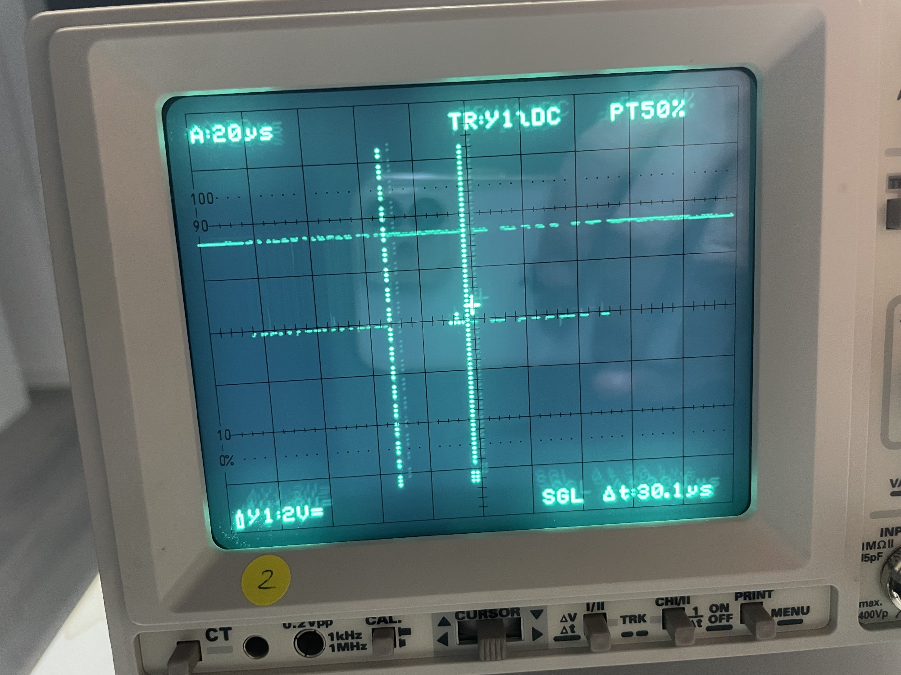

# 001 — перший запуск на залізі

**Дата:** 2026-10-13.

**Прошивка:** етап B з debug-ніжкою: відповідь 30 000 eRPM на кожен кадр, останній коміт коду `dc6b6f3`.

**Стенд:** FC (Betaflight, DSHOT300, `dshot_bidir = ON`) → GPIO0 RP2040.

**Дані:** вивід RP2040 по USB, записаний через `tio`, рядок кожні 500 мс (формат рядка описано в `README.md`); фото осцилограми лінії `IMG_6166.jpg`, розбір — розділ 4.

| Файл | Рядків | Значення `thr` | Ріст `bad` | Ріст `txf` |
|---|---|---|---|---|
| `tio_ttyACM0_2026-10-13T21_16_30.log` | 157 (≈ 78 с) | 792 → 402 → 1036 (і проміжні) | +9 | +297 |
| `tio_ttyACM0_2026-10-13T21_34_52.log` | 41 (≈ 20 с), починається з `no frames` | 1030 → 492 | +35 | +76 |
| `tio_ttyACM0_2026-10-13T21_37_10.log` | 23 (≈ 11 с) | 492 → 1357 | +14 | +43 |

> **Коротко.** Прийом працює: кадри приходять з частотою ≈ 4 кГц, `thr` іде за газом. Але поки `tio` читає вивід, лічильники `bad` і `txf` ростуть: приблизно на 1 і на 2 кожні 500 мс. Без `tio` вони майже стоять. Гіпотеза: надсилання по USB затримує задачу PIO, і через це переповнюються RX і TX FIFO. Осцилограма показує, що RP2040 відповідає з правильною паузою ≈ 30 мкс.

## 1. Що працює

- **Кадри приходять.** `n` росте, `thr` змінюється з газом і тримається стабільно.
- **Частота кадрів правильна.** За 500 мс приходить ≈ 2024 кадри, тобто ≈ 4048 кадрів/с. Це збігається з PID-циклом 4 кГц (`pid_process_denom = 2`).
- **Біт T і команди.** У всіх рядках `T=0`, `cmd=0`.
- **Поганих кадрів у знімках немає.** Рядок `BAD_CRC` не з'явився жодного разу, бо знімок показує лише останній кадр, а погані кадри рідкісні.

Розриви в `n` (+278 874 у лозі 21:16, +474 739 у лозі 21:37, а також різкий стрибок з 0 до 1,5 млн на початку логу 21:34) — це проміжки, коли `tio` не був під'єднаний, а лічильник далі рахував. Проблемою вони не є.

## 2. Лічильники `bad` і `txf`

Обидва рахує задача `pio_task_sm0` (`src/main.rs`). Вони ростуть з моменту старту плати і ніколи не скидаються.

- **`bad`** — кадри, в яких `decode_frame` не зійшлася за CRC. Норма: 0 або дуже рідкісні поодинокі помилки.
- **`txf`** — скільки разів `try_push` не поклав відповідь, бо TX FIFO (4 слова) повний. Задача кладе одне слово на кадр, PIO забирає одне слово на кадр, тож між кадрами в черзі завжди лежить 1 слово. **Норма: `txf = 0` завжди.**

### Частка поганих кадрів

Приріст `bad`, поділений на приріст `n` між сусідніми рядками:

| Лог | Лише час із записом | Разом з розривами | Від старту плати (`bad` / `n` в останньому рядку) |
|---|---|---|---|
| 21:16 | 9 / 313 774 = **0,0029 %** | 9 / 592 648 = 0,0015 % | 14 / 3 208 126 = 0,0004 % |
| 21:34 | 35 / 78 942 = **0,044 %** | так само | 36 / 1 583 157 = 0,0023 % |
| 21:37 | 12 / 42 513 = **0,028 %** | 14 / 517 252 = 0,0027 % | 54 / 2 104 453 = 0,0026 % |

### Помилки накопичуються лише під час виводу в USB

| Проміжок без `tio` | Кадрів | Приріст `bad` | Приріст `txf` |
|---|---|---|---|
| до першого рядка логу 21:34 | ≈ 1 504 000 | +1 | +2 |
| розрив у лозі 21:16 | 278 874 | 0 | +3 |
| розрив у лозі 21:37 | 474 739 | +2 | +3 |

Поки `tio` читає, `bad` росте приблизно на 1, а `txf` на 2 кожні 500 мс, тобто з кожним надісланим рядком. Отже, причина, швидше за все, в прошивці, а не в проводці.

## 3. Гіпотеза: USB затримує задачу PIO

Механізм, який пояснює і `bad +1`, і `txf +2` за одну подію. Це поки не перевірено.

1. Задача на якийсь час (≥ 1 мс, тобто ≥ 4 кадри) не забирає слова з RX. Ймовірно, executor у цей момент зайнятий USB (`usb_write`, обробник переривання USB).
2. **TX спорожніє.** PIO далі приймає кадри і на кожен робить `pull`. Запасу вистачає на один кадр. Далі `pull noblock` бере з порожнього FIFO значення X (усі одиниці): лінія лишається високою, і **FC не отримує відповіді**. Такий `pull` слово з черги не забирає.
3. **RX переповнюється.** RX FIFO теж вміщує лише 4 слова. Коли він повний, autopush зупиняє PIO на інструкції `in` посеред кадру. Коли задача забирає слово, PIO продовжує з середини вже іншого кадру. Так з'являється **кадр зі зсунутими бітами: `bad +1`**.
4. **Надлишок у TX.** Задача доганяє і за кожне накопичене слово RX кладе відповідь. Частину `pull` PIO зробив із порожньої черги, тож вона заповнюється до 4, а надлишок відкидається: **`txf +1` за кожну зайву відповідь**.

**Наслідки:**
- кадр зі зсунутими бітами відкидається;
- кілька кадрів FC лишаються без відповіді, і FC рахує це як помилки телеметрії;
- після такої події черга може лишатися повнішою, ніж треба, тож відповідь відстає від кадру на 2–3 кадри. Для фіксованих 30 000 eRPM це не має значення, а на етапі C eRPM відставатиме.

## 4. Осцилограма

**Налаштування:** 20 мкс на поділку, Y1 2 В на поділку (DC), синхронізація по Y1, pre-trigger 50 %, одиночний запуск (SGL), курсори Δt = **30,1 мкс**. Один канал, лінія GPIO0.

При 20 мкс на поділку окремих бітів не видно: осцилограф показує лише точки на двох рівнях. Межі пакетів при цьому читаються, тому тривалості оцінено по сітці (≈ 122 пікселі на поділку):

| Ділянка | По фото | Очікувано |
|---|---|---|
| Точки на обох рівнях до лівого курсора: кадр FC | ≈ 50 мкс (лівий край, можливо, обрізаний) | 16 × 3,33 = 53,3 мкс |
| Між курсорами лінія лише висока: пауза | **30,1 мкс** | 29,3 або 30,6 мкс залежно від останнього біта кадру |
| Точки на обох рівнях після правого курсора: відповідь RP2040 | ≈ 52–55 мкс | 21 × 2,67 = 56 мкс |
| Перепад між рівнями | ≈ 1,6 поділки ≈ 3,2 В | 3,3 В |

**Що підтверджено** (якщо картину трактовано правильно):
- RP2040 справді відповідає;
- відповідь починається через ≈ 30 мкс після кадру, тобто пауза в PIO правильна;
- тривалість відповіді схожа на 21 біт;
- лінія в спокої висока, рівні повні: 0 і 3,3 В.

**Чого з фото не видно:**
- форми окремих бітів (3,33 і 2,67 мкс, частки 75 % і 37,5 %);
- чи бувають кадри без відповіді, тобто гіпотези з розділу 3.

## 5. Що перевірити далі

- [ ] `dshot_telemetry_info` у CLI FC: чи видно 30 000 eRPM і яка частка помилок, з `tio` і без нього.
- [ ] Осцилограф 2–5 мкс на поділку із затримкою розгортки: форма бітів кадру і відповіді окремо.
- [ ] Другий канал на GPIO3 в момент виводу в USB: чи бувають кадри без відповіді (GPIO3 не піднімається).
- [ ] Лічильник у прошивці: скільки разів PIO зробив `pull` з порожнього TX FIFO.
- [ ] Знайти, що саме блокує задачу PIO на ≥ 1 мс, і прибрати це: наприклад, винести прийом у переривання або окреме ядро, або дати задачі PIO вищий пріоритет.
