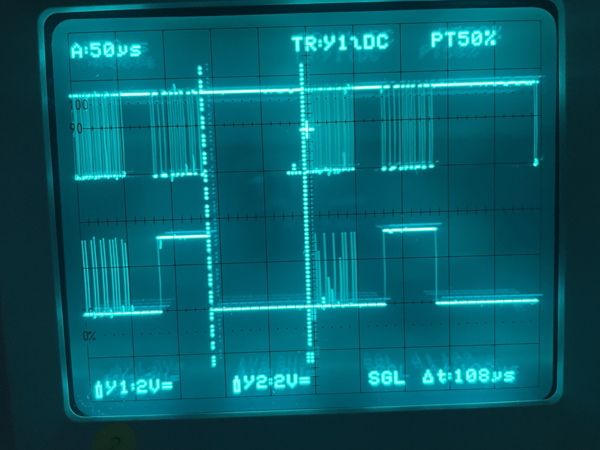
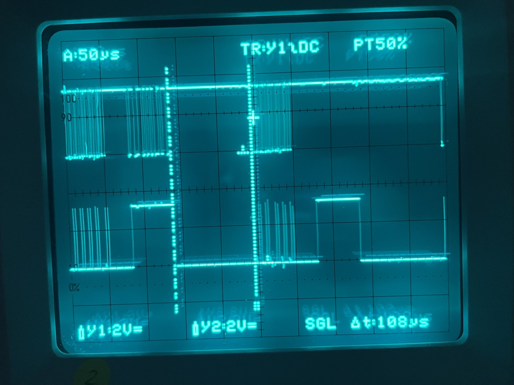

# 002 — RX без зупинок PIO

**Дата:** 2026-10-14.

**Прошивка:** кроки 1–3 з `docs/rx-overflow-plan.md`, коміт `f00c157`:
- PIO: `push noblock` замість autopush;
- задача забирає з RX усі кадри і відповідає за останнім;
- у рядку USB нові поля `late` і `gap`.

Відповідь, як і раніше, фіксована: 30 000 eRPM. Чи прошивалася debug- чи release-збірка, не записано.

**Стенд:** FC TBS Lucid (Betaflight, DSHOT300, `dshot_bidir = ON`). RP2040 під'єднаний до **мотора 4** (у CLI це вихід 3). Газ задавався повзунком у вкладці Motors у Configurator.

**Дані:**
- 6 логів `tio` з RP2040: `ttyACM0` або `ttyACM1`, бо коли FC під'єднаний, він займає ACM0;
- 2 логи CLI Betaflight (`BTFL_cli_*.txt`);
- 2 фото осцилограм GPIO0 і GPIO3 (`IMG_6190.jpg`, `IMG_6191.jpg`), розбір — розділ 4.

Порівняння з першим запуском: `reports/001-first-try/findings.md`.

> **Коротко.**
> - Зміни спрацювали: `bad` і `txf` не росли в жодному рядку.
> - Гіпотезу підтверджено: поки `tio` читає вивід, задача PIO на кожен надісланий рядок засинає на 1,1–1,9 мс (`late` +1 за рядок), а без `tio` майже ніколи.
> - Betaflight бачить 30 000 eRPM, Invalid 0 %.
> - Лишається: ≈ 5 кадрів кожні 0,5 с без відповіді (≈ 0,25 %), бо задача все одно спить; це крок 4 плану. Один такий кадр спіймано на осцилограмі.
> - GPIO3 (debug) працює: у першому запуску сигналу не було через налаштування осцилографа.

## 1. Логи RP2040

Приріст лічильників між сусідніми рядками, лише за час запису:

| Лог | Рядків | Кадрів у записі | `bad` | `txf` | `late` за рядок | `gap` мін / сер / макс, мкс | `thr` |
|---|---|---|---|---|---|---|---|
| `tio_ttyACM0_2026-10-14T20_41_12.log` | 219 | 439 252 | +0 | +0 | 1,03 | 1198 / 1669 / 1872 | 690, 850, 1237 (і проміжні) |
| `tio_ttyACM0_2026-10-14T21_21_10.log` | 389 | 783 483 | +0 | +0 | 1,03 | 1127 / 1665 / 1889 | 690, 1499 |
| `tio_ttyACM0_2026-10-14T21_24_31.log` | 58 | 111 287 | +0 | +0 | 1,02 | 1397 / 1604 / 1840 | 690 |
| `tio_ttyACM0_2026-10-14T21_25_48.log` | 52 | 101 164 | +0 | +0 | 1,00 | 1377 / 1586 / 1790 | 690 |
| `tio_ttyACM1_2026-10-14T21_41_11.log` | 35 | 66 793 | +0 | +0 | 1,00 | 1220 / 1717 / 1867 | 0, 1022 |
| `tio_ttyACM1_2026-10-14T21_43_33.log` | 26 | 48 560 | +0 | +0 | 1,00 | 1394 / 1604 / 1761 | 1022 |

- **`bad` і `txf` не росли.** У першому запуску вони росли приблизно на +1 і +2 за рядок. Лог 21:21 починається з `bad=9`, але ці кадри накопичилися ще до початку запису, за попередні 10,6 млн кадрів.
- **`late` росте рівно на ≈ 1 за рядок.** В усіх 766 проміжках між рядками `gap` ≥ 1,1 мс. Зрідка (17 разів) `late` зростає на 2.
- **Частота кадрів.** `n` росте на ≈ 2024 за рядок, як і в першому запуску: ≈ 4 кГц.
- **Перезавантаження.** У лозі 21:24 `n` посеред запису скинувся з 11,46 млн до 90 378. Це перезавантаження або перепрошивка RP2040, з самою зміною не пов'язане.

### Без `tio` затримок майже немає

| Розрив у записі | Кадрів | `bad` | `txf` | `late` |
|---|---|---|---|---|
| до першого рядка логу 20:41 (від старту) | 950 587 | +0 | +0 | +12 |
| у лозі 21:25 | 187 752 | +0 | +0 | +2 |
| у лозі 21:41 | 1 614 021 | +0 | +0 | +2 |
| у лозі 21:43 | 128 425 | +0 | +0 | +2 |

За хвилини без `tio` `late` росте лише на 2. Ймовірно, ці 2 — моменти під'єднання і від'єднання терміналу. Отже, задачу затримує саме надсилання рядків по USB.

## 2. Betaflight

`dshot_telemetry_info` (лог `BTFL_cli_20261014_214232_TBS_LUCID_FC.txt`):

| Мотор | Type | eRPM | RPM | Hz | Invalid |
|---|---|---|---|---|---|
| 1–3 | `-----` | 0 | 0 | 0 | NO DATA |
| 4 | `R----` | 30 000 | 4286 | 71 | 0,00 % |

- **Розрахунок.** 4286 RPM = 30 000 eRPM / 7 пар полюсів (`motor_poles = 14`); 71 Гц = 4286 / 60.
- **Без помилок.** «Dshot invalid pkts: 0» на 1 186 906 прочитаних відповідей. У лозі 21:37 так само: 0 на 22 633, 288 097 і 400 477 прочитаних.
- **Команда `motor` з CLI газ не змінила.** `motor 4 …` відхилено (виходи 0–3). `motor 3 1477` відповів `motor 3: 1000`, тобто газ не застосувався. Чому, не з'ясовано. На стенді газ задавався з Configurator.

## 3. Що лишається

Затримки не зникли, але тепер вони не збивають PIO. Оцінка, що відбувається за одну затримку ≈ 1,7 мс (≈ 6–7 кадрів по 250 мкс):

| Кадри під час затримки | Що з ними |
|---|---|
| перший | отримує відповідь, яка вже лежала в TX |
| решта, ≈ 5–6 | **без відповіді**: TX порожній, `pull noblock` → лінія лишається високою |
| перші 4 з них | лежать у RX FIFO, задача потім їх рахує |
| понад 4, ≈ 2–3 | **відкинуті** `push noblock`, у `n` не потрапляють |

Тобто ≈ 5 кадрів кожні 0,5 с лишаються без відповіді: ≈ 0,25 %. Betaflight показує Invalid 0 %, тож відсутню відповідь він, схоже, поганим пакетом не вважає. Це оцінка: прямо пропущені відповіді й відкинуті кадри ніхто не рахує.

## 4. Осцилограми

**Налаштування:** 50 мкс на поділку, обидва канали 2 В на поділку (DC), одиночний запуск (SGL), курсори Δt = **108 мкс**. Y1 (зверху) — GPIO0, лінія DShot. Y2 (знизу) — GPIO3, debug (side-set).

Невеликий зсув між каналами по горизонталі — це перспектива фото: курсори теж нахилені.

### IMG_6191: два нормальні обміни

Тривалості оцінено по сітці (≈ 150 пікселів на поділку = 50 мкс):

| Ділянка | По фото | Очікувано |
|---|---|---|
| Кадр FC (пачка спадів на Y1) | ≈ 53 мкс | 53,3 мкс |
| Пауза | ≈ 30 мкс | ≈ 30,8 мкс |
| Відповідь RP2040 | ≈ 55 мкс | 56 мкс |
| Від кінця відповіді до наступного кадру (курсори) | **108 мкс** | 250 − 53 − 31 − 56 ≈ 110 мкс |
| Від кадру до кадру | ≈ 255 мкс | 250 мкс (4 кГц) |

**GPIO3 (Y2):**
- під час кадру — тонкі голки, по одній на кожну вибірку біта (імпульси ≈ 170 нс);
- під час відповіді — суцільний високий рівень ≈ 55 мкс, рівно поки RP2040 керує лінією;
- амплітуда ≈ 3,3 В.

Отже, debug-ніжка працює так, як задумано. У першому запуску (`reports/001-first-try/findings.md`, розділ 6) сигналу не було через налаштування осцилографа.

При 50 мкс на поділку не видно, чи стоять голки посередині бітів (≈ 1,67 мкс після спаду); для цього потрібна розгортка 1–2 мкс на поділку.

### IMG_6190: обмін без відповіді

Перший обмін такий самий, як на IMG_6191. У другому:
- **Y1:** після кадру FC лінія лишається високою до наступного кадру, пачки відповіді немає;
- **Y2:** через ≈ 30 мкс після кадру з'являється звичайний високий рівень ≈ 55 мкс. Отже, PIO відпрацював відповідь як зазвичай: перемкнув пін на вихід і видав 21 рівень.

Найімовірніше, це випадок з розділу 3: TX FIFO був порожній, `pull noblock` узяв X (усі одиниці), і PIO вивів на лінію 21 одиницю, тобто «нічого». Задача PIO в цей момент спала. Гарантувати це не можна: спіймати такий кадр одиночним запуском — шанс ≈ 0,25 % на обмін. Але інших причин, з якими PIO піднімає GPIO3 без пачки на лінії, у поточному коді немає.

Це перше пряме підтвердження пропущених відповідей, які в розділі 3 були лише оцінкою.

## 5. Висновки

| Що перевіряли (`docs/rx-overflow-plan.md`, розділ 5) | Очікувано | Результат |
|---|---|---|
| `bad` з `tio` | ≈ 0 | ✅ 0 |
| `txf` з `tio` | 0 | ✅ 0 |
| `late` з `tio` / без `tio` | росте з `tio`, майже ні без | ✅ ≈ 1 за рядок / +2 за хвилини |
| `gap` під час затримки | ≥ 1000 мкс | ✅ 1127–1889 мкс |
| Err у Betaflight | ≈ 0 | ✅ Invalid 0,00 % |

Кроки 1–3 плану перевірено на стенді.

## 6. Що далі

- [ ] Крок 4 плану: з'ясувати, що в `usb_write` займає ≈ 1,7 мс. Найдешевша перевірка — прошити release-збірку (`cargo run --release`), бо форматування через `core::fmt` без оптимізацій повільне. Далі — виміряти окремо `format_stats` і `write_packet`.
- [ ] Записувати, яку збірку прошито (debug чи release).
- [x] GPIO3 (debug) працює (розділ 4).
- [ ] Положення голок GPIO3 відносно бітів кадру: розгортка 1–2 мкс на поділку.
