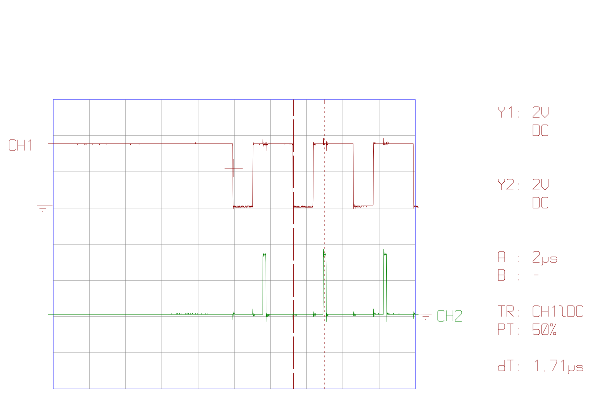
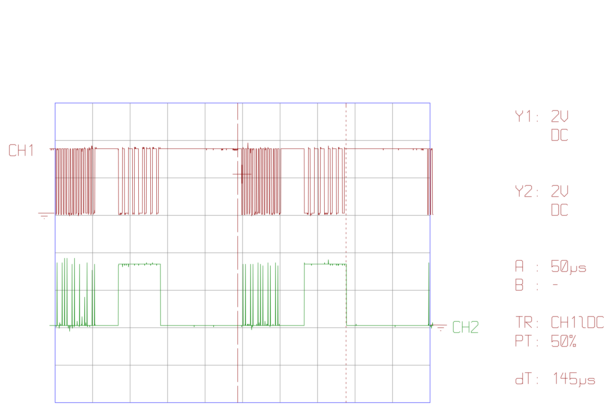
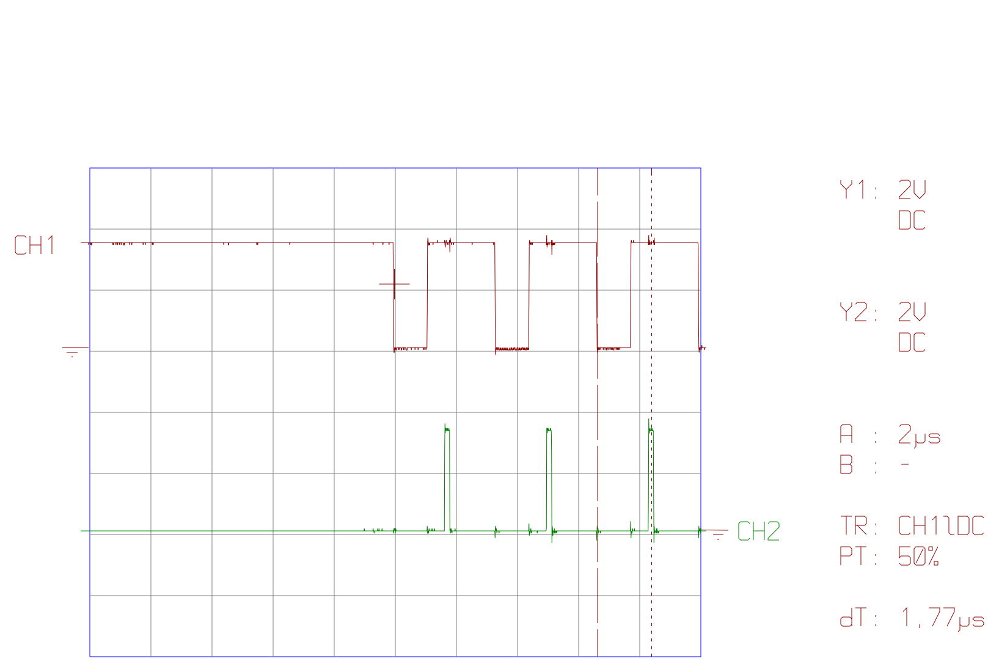
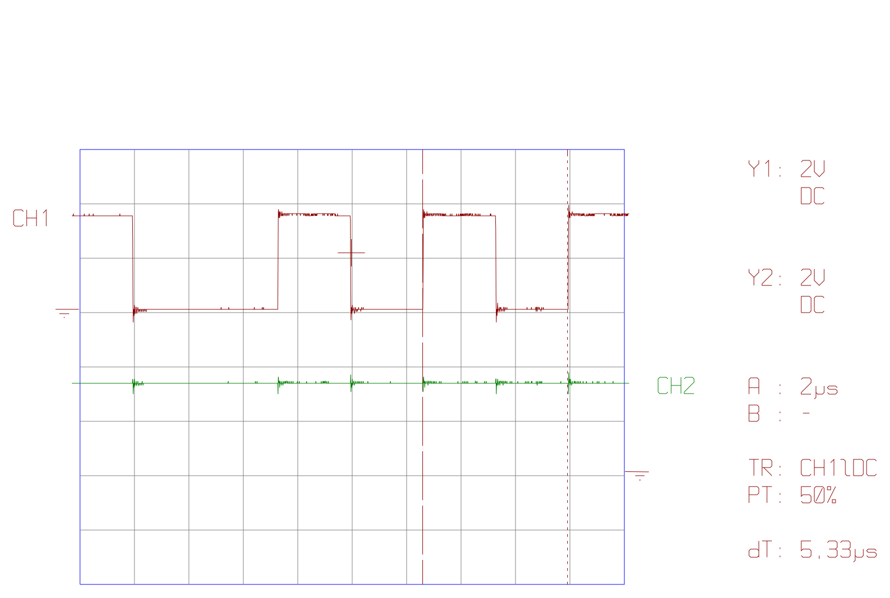
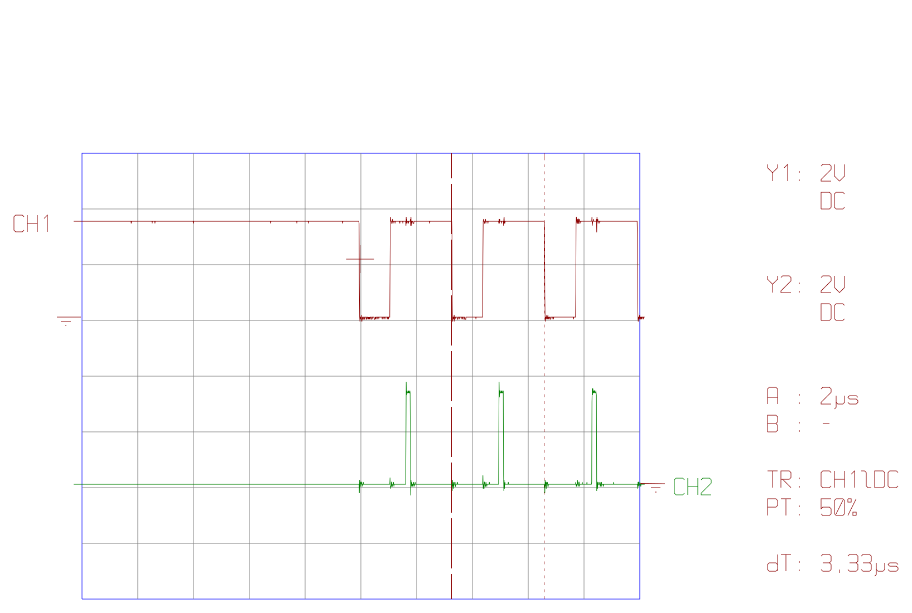
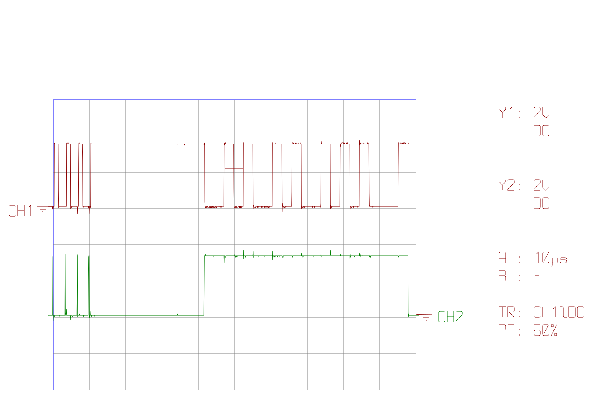
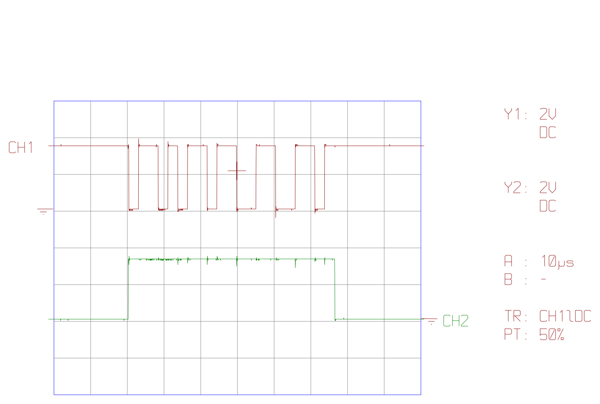

# 003 — день третій: етап C

**Дата:** 2026-10-15.

**Прошивка:** етап C, коміт `61118dd`. Відповідь лінійно залежить від газу:
- eRPM = 1000 + газ × 20;
- для команд (газ 0…47) — «мотор стоїть» (`0xFFF`).

Разом з цим лишаються зміни з `docs/rx-overflow-plan.md`: `push noblock`, задача забирає з RX усе, поля `late` і `gap`. Прошито **release-збірку** (`--release`).

**Стенд:** як у `reports/002-rx-overflow-fixed/findings.md`:
- FC TBS Lucid (Betaflight, DSHOT300, `dshot_bidir = ON`), RP2040 на **моторі 4** (у CLI це вихід 3);
- газ задавався командою `motor 3 …` з CLI.

**Дані:**

| Файл | Що |
|---|---|
| `tio_ttyACM0_2026-10-15T22_33_12.log` | вивід RP2040 по USB, 396 рядків (≈ 3 хв) |
| `BTFL_cli_20261015_214753_TBS_LUCID_FC.txt`, `2BTFL_cli_20261015_223634_TBS_LUCID_FC.txt` | CLI Betaflight: команди `motor` і `dshot_telemetry_info` |
| `tio_ttyUSB0_*.svg` (7 файлів) | осцилограми, експортовані з осцилографа через його послідовний порт (`ttyUSB0`). CH1 (червоний) — GPIO0, лінія DShot; CH2 (зелений) — GPIO3, debug |

> **Коротко.**
> - **Етап C працює.** Betaflight показує eRPM точно за моделлю: газ 48 → 2 000, 1000 → 21 000, 2047 → 42 000, команди → 0. Invalid 0 %. Дві відповіді на осцилограмах декодовано вручну: `0xFFF` і `0x765`, CRC сходиться.
> - **USB більше не затримує задачу PIO.** `gap` ≈ 250 мкс, `late` за 3 хвилини зріс лише на 3, і то через паузу з боку FC. Затримки ≈ 1,7 мс з дня другого, найімовірніше, давала debug-збірка: сьогодні прошито release (див. розділ 2).
> - **Таймінги, виміряні з точністю до 20 нс по SVG,** збігаються з розрахованими: біт кадру 3,33 мкс, біт відповіді 2,667 мкс, пауза 31,3 мкс, відповідь 56 мкс, вибірка ≈ 1,7 мкс після спаду.
> - **Нове спостереження:** FC тримає лінію низькою ≈ 1,10 мкс для `0` і ≈ 2,22 мкс для `1` (33 % і 67 % біта), а не 37,5 % і 75 %, як у наших документах. Запас вибірки від цього майже вирівнюється: ≈ 0,65 і ≈ 0,47 мкс.

## 1. Статистика RP2040 (`tio`)

Лог записано під час другої сесії CLI (22:33–22:36). Газ у рядках змінювався в тому самому порядку, що й команди `motor` в `2BTFL_cli_…223634…txt`:

| Рядки логу | Кадр | `thr` | Команда в CLI | Відповідь за моделлю |
|---|---|---|---|---|
| 1–32 | — | `no frames` | (FC ще не шле кадри) | — |
| 33–114 | `000F` | 0 (`cmd=1`) | — | `0xFFF`, 0 eRPM |
| 115–162 | `7D05` | 1000 | `motor 3 1477` | 21 008 eRPM |
| 163–228 | `FFE1` | 2047 | `motor 3 2000` | 42 017 eRPM |
| 229–284 | `0D46` | 106 | `motor 3 1030` | 3 120 eRPM |
| 285–336 | `82C9` | 1046 | `motor 3 1500` | 21 920 eRPM |
| 337–357 | `000F` | 0 (`cmd=1`) | `motor 3 1000` | `0xFFF`, 0 eRPM |
| 358–396 | `7D05` | 1000 | `motor 3 1477` | 21 008 eRPM |

**Лічильники за весь лог (363 рядки з кадрами, 734 050 кадрів):**

| Що | Значення | День другий (`002`) |
|---|---|---|
| `bad` | **0** | 0 |
| `txf` | **0** | 0 |
| `late` | **+3** за весь лог | ≈ +1 за кожен рядок |
| `gap` < 300 мкс | 324 рядки (89 %) | 0 рядків |
| `gap` 300–999 мкс | 37 рядків (10 %) | 0 рядків |
| `gap` ≥ 1000 мкс | 2 рядки | усі рядки (1,1–1,9 мс) |
| кадрів за рядок | 2021–2023 (≈ 4040 кадрів/с) | ≈ 2024 |

Розбір:
- **`bad` і `txf` = 0** — як і в день другий.
- **`gap` ≈ 252–335 мкс у більшості рядків.** Це майже рівно період кадрів FC (250 мкс): задача прокидається на кожен кадр. Значення до 335 мкс — це, ймовірно, тремтіння циклу FC. Чотири рядки з `gap` ≈ 619 мкс — один пропущений кадр з боку FC (≈ 2,5 періоду).
- **`late` +3 лише в рядках 91–92** (`gap` 3 956 і 69 372 мкс). Це FC тимчасово перестав надсилати кадри, а не затримка RP2040: у цих рядках бракує 102 і 421 кадру (`n` зріс на 1 920 і 1 601 замість ≈ 2 022). Якби спав RP2040, PIO далі приймав би кадри в RX FIFO, а пропусків було б щонайбільше gap / 250 − 4. Ймовірно, це момент входу в CLI або виконання команди на FC.
- **Без затримок USB немає й пропущених відповідей,** які в день другий оцінювалися в ≈ 0,25 %.

## 2. Чому зникли затримки USB

У день другий (`reports/002-rx-overflow-fixed/findings.md`) кожен рядок USB затримував задачу PIO на 1,1–1,9 мс. Сьогодні з тим самим кодом виводу затримок немає. Між комітами `f00c157` (день другий) і `61118dd` (сьогодні) змінилася лише модель відповіді, вивід USB той самий.

Сьогодні прошито **release-збірку** (`--release`), і це майже напевно причина. У день другий, найімовірніше, була debug-збірка (`cargo run` без `--release`), хоча тоді це не записали.

**Чому release прибирає затримку.** Задача PIO і `usb_write` виконуються в одному executor, і поки `usb_write` рахує рядок, задача PIO чекає. Найважча частина — `format_stats`: шість чисел u32 через `write!`, тобто `core::fmt`. У debug-збірці (`opt-level = 0`) кожен виклик там робиться повільно: усі абстракції `core::fmt` лишаються без вбудовування (inline), без розгортання циклів, з перевірками меж і переповнення. Повільнішими стають і embassy-usb та сам executor.

Затримка 1,7 мс — це ≈ 210 000 тактів при 125 МГц. Для неоптимізованого `core::fmt` на Cortex-M0+, де немає апаратного ділення (а воно потрібне на кожну цифру), це правдоподібно. У release те саме займає, ймовірно, десятки мікросекунд, тобто менше за період кадру 250 мкс, тож задача встигає між кадрами.

**Що підтверджує дані:**
- **Код той самий.** Між днем другим (`f00c157`) і третім (`61118dd`) код виводу в USB не змінювався.
- **Затримка йшла за рядком.** Вона з'являлася рівно раз на рядок, тобто саме тоді, коли формується і надсилається текст.
- **`gap` сьогодні стабільний.** Він тримається ≈ 252–335 мкс навіть у рядках з виводом.

**Як довести остаточно.** Прошити ту саму версію через `cargo run` (debug) і подивитися, чи повернуться `late` ≈ +1 за рядок і `gap` ≈ 1,7 мс.

**Наслідки:**
- **Прошивати лише release.** Крок 4 `docs/rx-overflow-plan.md` (прибрати затримку) з release, схоже, не потрібен.
- **Захист від затримок лишається корисним.** `push noblock` і «забрати все» роблять прошивку стійкою, якщо щось знову затримає задачу.
- **Можна закріпити release як варіант за замовчуванням.** Наприклад, додати `opt-level = "s"` до `[profile.dev]` або змінити runner, щоб випадкова debug-прошивка не повернула проблему.

## 3. Betaflight

`motor 3 <значення>` друкує **не** те, що отримав, а значення DShot, яке з нього вийшло: 48 + (значення − 1001) × 1999 / 999 з округленням униз, 1000 → 0.

| `motor 3 …` | Друкує (газ DShot) | `thr` у `tio` | eRPM у Betaflight | RPM | Hz | Invalid |
|---|---|---|---|---|---|---|
| 1000 | 0 | 0 | **0** | 0 | 0 | 0,00 % |
| 1001 | 48 | — | **2 000** | 286 | 4 | 0,00 % |
| 1030 | 106 | 106 | — | — | — | — |
| 1400 | 846 | — | — | — | — | — |
| 1477 | 1000 | 1000 | **21 000** | 3 000 | 50 | 0,00 % |
| 1500 | 1046 | 1046 | — | — | — | — |
| 2000 | 2047 | 2047 | **42 000** | 6 000 | 100 | 0,00 % |

- **eRPM збігається з моделлю з точністю до округлення.** Модель після e12 дає 1 961, 21 008, 42 017 eRPM. Betaflight показує eRPM, округлене до сотень, — 2 000, 21 000, 42 000 — тож, схоже, зберігає його в одиницях по 100 eRPM.
- **RPM = eRPM / 7** (`motor_poles = 14`): 2 000 / 7 = 286, 21 000 / 7 = 3 000. **Hz = RPM / 60** з відкиданням дробу: 286 / 60 = 4,8 → 4.
- **«Dshot invalid pkts: 0»** у всіх замірах, до 3 833 850 прочитаних відповідей.
- **Поправка до звіту 002.** Там написано, що `motor 3 1477` → `motor 3: 1000` означає «газ не застосувався». Це неправильно: 1000 — це газ DShot, який вийшов з 1477, тобто команда спрацювала.

Критерій готовності етапу C з `docs/action-plan.md` («оберти у Betaflight відповідають моделі на всьому діапазоні газу») виконано на крайніх точках (48, 2047), посередині (1000) і на командах (0). Для 106 і 1046 телеметрію в Betaflight не знімали.

## 4. Осцилограми

**Як рахувалося.** Осцилограф віддає SVG з точними координатами: сітка 100 пікселів на поділку, екран 10 × 8 поділок. Тож при 2 мкс на поділку 1 піксель = 20 нс. Фронти взято програмно як перетин середини між високим і низьким рівнем. На відміну від фото у звітах 001 і 002, перспективи тут немає, і пікселі можна рахувати.

На всіх осцилограмах:
- CH1 і CH2 — 2 В на поділку (DC), синхронізація по спаду CH1, точка запуску посередині екрана (PT 50 %);
- перепад CH1 ≈ 3,5 В (1,8 поділки), CH2 ≈ 3,4 В;
- на CH2 видно короткі викиди на кожному фронті CH1: це наводка між щупами (спільний провід землі), а не сигнал GPIO3.

### `tio_ttyUSB0_2026-10-15T21_28_43.svg` — вибірка бітів кадру, 2 мкс на поділку



Початок кадру FC: до спаду в центрі екрана лінія висока (пауза між кадрами), далі три біти `0`. Вони ж і в рядку `tio`: кадр `000F` починається з нулів.

| Що | Виміряно | Очікувано |
|---|---|---|
| Період біта (спад → спад) | 3,32 / 3,34 / 3,32 мкс | 3,333 мкс |
| Низький рівень біта `0` | 1,10 / 1,12 / 1,10 мкс | див. нижче |
| Спад CH1 → підйом голки CH2 | 1,66 / 1,68 / 1,67 мкс | 1,58 мкс + до 83 нс на виявлення спаду |
| Ширина голки | 0,17 мкс | 2 такти = 0,167 мкс |
| Курсори (dT) | 1,71 мкс | спад → голка |

Голка триває такти 19–21 після виявлення спаду, а `in pins, 1` читає лінію на 20-му такті — посередині голки. Тобто **вибірка відбувається ≈ 1,75 мкс після спаду**. Виміряний підйом голки на 1,66–1,68 мкс означає, що від спаду на лінії до першого такту PIO минає ≈ 80–100 нс: синхронізатор входу плюс до одного такту PIO (83 нс).

### `tio_ttyUSB0_2026-10-15T21_30_11.svg` — два обміни, 50 мкс на поділку



Два повні обміни «кадр → пауза → відповідь». При 50 мкс на поділку один піксель — 0,5 мкс, тож окремі біти тут неточні, але межі вікон видно добре:

| Що | Виміряно | Очікувано |
|---|---|---|
| Вікно відповіді (CH2 високий) | 56,25 / 56,25 мкс | 2 такти + 21 × 2,667 + 1 такт = 56,25 мкс |
| Від вікна до вікна (період обміну) | 248,0 мкс | 250 мкс (4 кГц) |
| Від першого спаду кадру до початку вікна | 83,35 / 83,65 мкс | 15 × 3,333 + 2,2 (останній біт `1`) + 31,2 ≈ 83,4 мкс |
| Курсори (dT) | 145 мкс | від точки ≈ 5 мкс перед кадром до кінця відповіді; сам обмін (перший спад кадру → кінець вікна) — 139,9 мкс |

На CH2 добре видно обидві ролі GPIO3: голки під час кадру (по одній на біт) і суцільний високий рівень під час відповіді.

### `tio_ttyUSB0_2026-10-15T21_39_17.svg` — вибірка бітів кадру, 2 мкс на поділку



Повтор першої осцилограми на іншому кадрі: період біта 3,33 мкс, низький рівень `0` — 1,11 мкс, підйом голки через 1,67 / 1,68 / 1,70 мкс після спаду. Курсори: dT = **1,77 мкс** — від спаду до голки, ближче до її кінця (голка за SVG — 1,70–1,86 мкс після спаду). Результат той самий, тобто положення вибірки стабільне від кадру до кадру.

### `tio_ttyUSB0_2026-10-15T21_43_06.svg` — біти відповіді, 2 мкс на поділку



Фрагмент відповіді RP2040: CH2 увесь час високий — це вікно відповіді, голок немає.

| Що | Виміряно | Очікувано |
|---|---|---|
| Рівні на екрані | низький 5,34 мкс (2 біти), далі 2,66 / 2,67 / 2,67 / 2,66 мкс (по 1 біту) | біт 2,667 мкс |
| Курсори (dT) | **5,33 мкс** | 2 біти відповіді |

Вісім рівнів — замало, щоб однозначно визначити значення відповіді. Вони збігаються з рівнями 9–16 відповіді `0xFFF`, але можуть належати й іншій.

### `tio_ttyUSB0_2026-10-15T21_52_04.svg` — період біта кадру, 2 мкс на поділку



Та сама картина, що й 21:28 (три біти `0` на початку кадру, голка через 1,67 / 1,67 / 1,69 мкс після спаду). Курсори стоять на двох сусідніх спадах: dT = **3,33 мкс** — період біта DShot300 точно.

### `tio_ttyUSB0_2026-10-15T21_54_11.svg` — кінець кадру, пауза і відповідь `0xFFF`, 10 мкс на поділку



Ліворуч — останні три біти кадру FC, далі пауза і повна відповідь.

| Що | Виміряно | Очікувано |
|---|---|---|
| Низький рівень біта `1` (останні біти кадру) | 2,24 / 2,21 / 2,21 мкс | див. нижче |
| Від останнього підйому кадру до підйому CH2 (пауза) | **31,27 мкс** | ≈ 374 такти = 31,2 мкс: `wait`, `jmp`, `push`, `set y`, затримка 368, `pull`, `set pins` |
| Від підйому CH2 до старт-біта на CH1 | 0,13 мкс | 2 такти (0,167 мкс): `set y, 20`, потім перший `out` |
| Вікно відповіді (CH2) | 56,28 мкс | 56,25 мкс |

**Декодування відповіді.** Тривалості рівнів поділено на 2,667 мкс:

```
рівні:     0 0 1 0 1 0 0 1 0 1 0 0 1 0 1 0 1 0 0 0 1      (21 рівень)
NRZI → GCR:  01111 01111 01111 11001
GCR → ніббли:    F     F     F     0
```

e12 = **`0xFFF`** («мотор стоїть»), CRC = 0 = ¬(F ⊕ F ⊕ F) — сходиться. Рівні точно збігаються з `encode_reply(0xFFF)`. Кадр перед цим закінчується трьома бітами `1`: це кінець CRC `1111` кадру `000F` (газ 0), на який модель і має відповідати «мотор стоїть».

### `tio_ttyUSB0_2026-10-15T22_05_23.svg` — відповідь `0x765`, 10 мкс на поділку



Повна відповідь RP2040, вікно CH2 — 56,29 мкс. Від першого спаду (старт-біт, 20,40 мкс) до останнього фронту (73,75 мкс) — 53,35 мкс = 20 бітів, тобто **2,6675 мкс на біт**.

```
рівні:     0 1 1 0 1 0 1 1 0 1 1 0 0 1 1 0 0 1 1 0 1      (21 рівень)
NRZI → GCR:  10111 10110 10101 01011
GCR → ніббли:    7     6     5     B
```

e12 = **`0x765`**, CRC = B = ¬(7 ⊕ 6 ⊕ 5) — сходиться. Рівні точно збігаються з `encode_reply(0x765)`. За таблицею етапу C у `docs/action-plan.md` `0x765` — це газ 1000 → 21 008 eRPM. Betaflight на цьому газі показує 21 000 eRPM (розділ 3).

### Підсумок осцилограм: біти кадру FC

| Біт | Низький рівень | Частка біта | У наших документах |
|---|---|---|---|
| `0` | ≈ 1,10 мкс | 33 % | 1,25 мкс (37,5 %) |
| `1` | ≈ 2,22 мкс | 67 % | 2,5 мкс (75 %) |

FC тримає низький рівень коротше, ніж закладено в документах. Це близько до 35 % / 70 % (`MOTOR_BIT_0 = 7`, `MOTOR_BIT_1 = 14` з 20 у коді Betaflight; з пам'яті, на цій версії не перевірено).

Для прийому це навіть краще. Вибірка ≈ 1,75 мкс після спаду має запас:
- ≈ 0,65 мкс до підйому біта `0` (1,10 мкс);
- ≈ 0,47 мкс до підйому біта `1` (2,22 мкс).

Запаси майже рівні. У звіті 002 запас рахувався від 1,25 і 2,5 мкс (≈ 0,45 і ≈ 0,8 мкс).

## 5. Висновки

| Що | Результат |
|---|---|
| Етап C: eRPM у Betaflight за моделлю (0, 48, 1000, 2047) | ✅ 0 / 2 000 / 21 000 / 42 000, Invalid 0 % |
| Відповідь на осцилограмі збігається з `encode_reply` | ✅ `0xFFF` і `0x765`, CRC сходиться |
| `bad`, `txf` | ✅ 0 |
| Затримки задачі PIO через USB | ✅ немає (`late` +3 лише через паузу FC); найімовірніше, їх давала debug-збірка |
| Таймінги PIO (біт, пауза, вікно, вибірка) | ✅ у межах одного такту від розрахунку |
| Біти кадру FC | ⚠️ 33 % / 67 % замість 37,5 % / 75 % у документах; на прийом не впливає |

## 6. Що далі

- [ ] Прошити debug-збірку і перевірити, чи повертаються затримки ≈ 1,7 мс: це остаточно підтвердить причину.
- [ ] Закріпити release за замовчуванням (`opt-level` у `[profile.dev]` або runner), щоб випадкова debug-прошивка не повернула затримки.
- [ ] Записувати у звітах, яку збірку прошито.
- [ ] Телеметрія в Betaflight для проміжних значень газу (106, 1046) — для повноти таблиці етапу C.
- [ ] Виправити частки 75 % / 37,5 % у документах (`bidirectional-dshot-plan.md`, `rx-bit-timing*.pdf`, `throttle-explained.md`) або дописати, що Betaflight фактично шле ≈ 70 % / 35 %.
- [ ] Етап 6 плану: крайові випадки.
